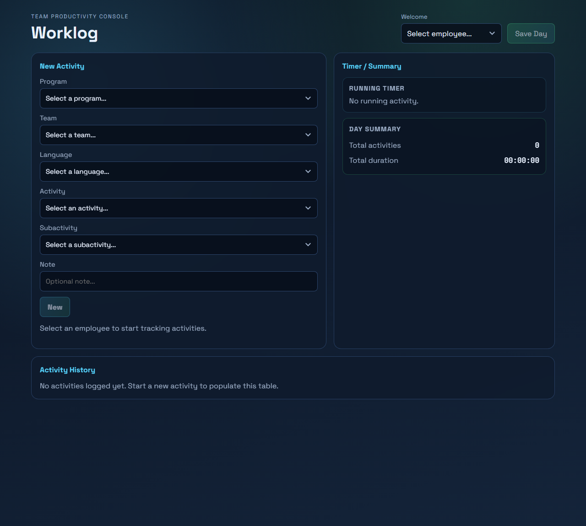
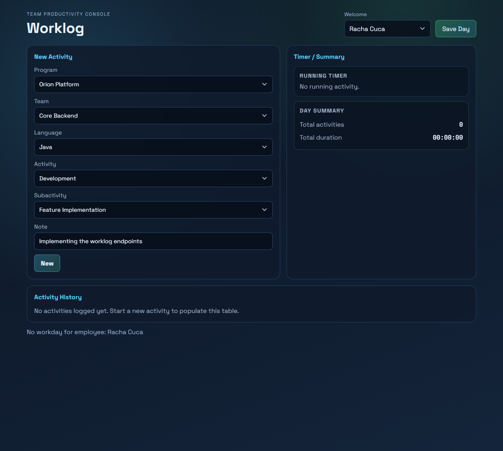
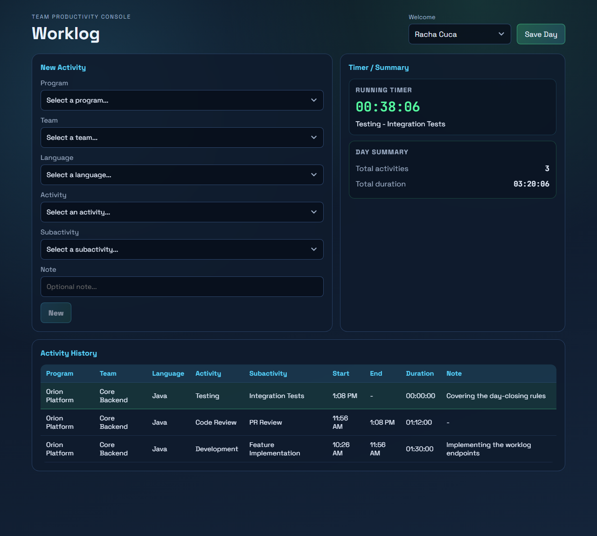
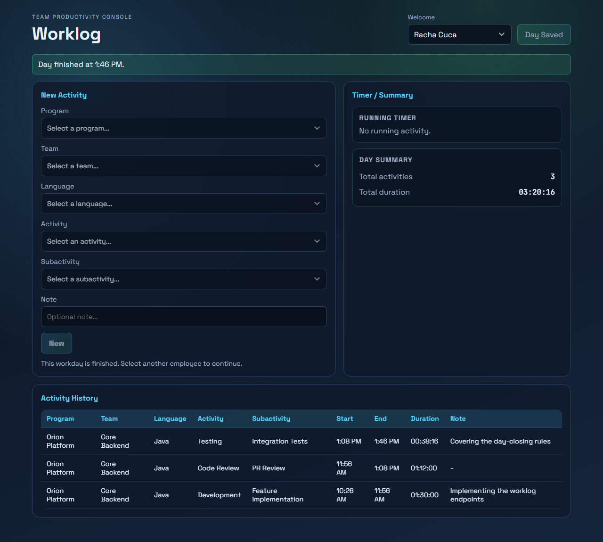
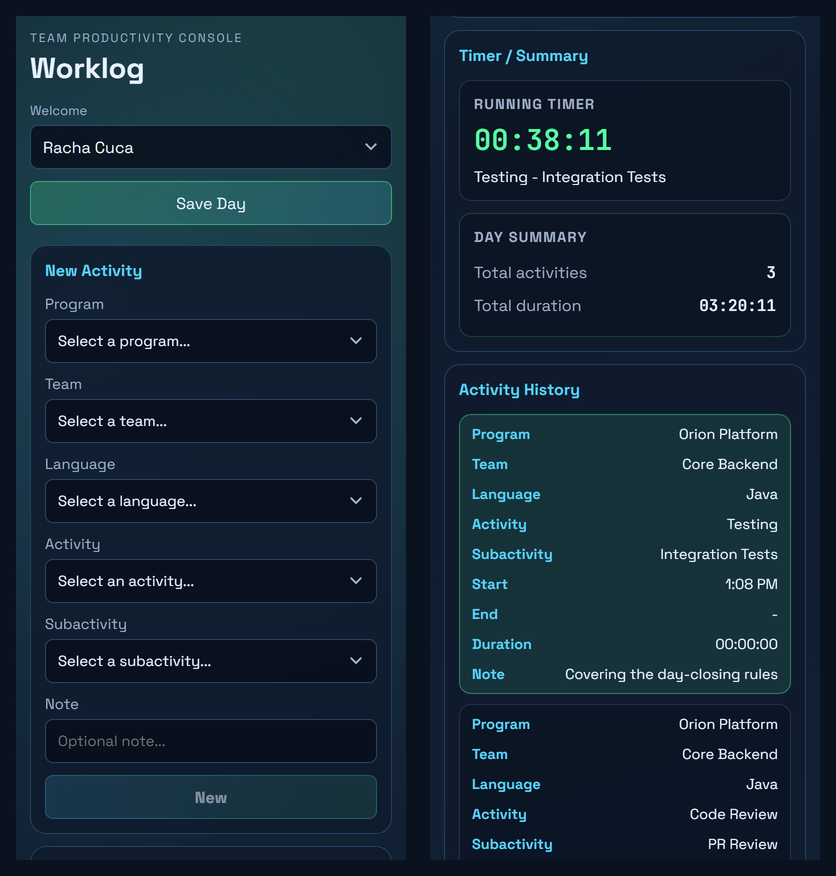
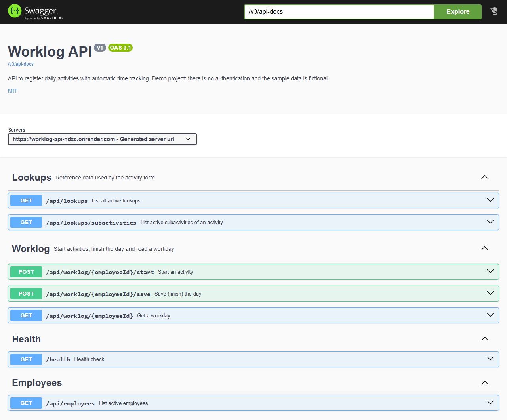
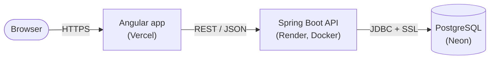

<!-- markdownlint-disable MD033 MD034 MD036 MD060 -->
<h1 align="center">Worklog</h1>

<p align="center">
  Track your daily work activities with automatic time tracking.<br>
  A full-stack portfolio project built with Spring Boot, Angular and PostgreSQL.
</p>

<p align="center">
  <a href="https://worklogtrack.vercel.app"></a>
  <a href="https://github.com/pitercoding/worklog/actions/workflows/ci.yml"></a>
  <a href="LICENSE"></a>
</p>

<p align="center">
  
  
  
  
  
  
  
  
  
  
  
</p>

---

## What is Worklog?

Worklog is a small web app where an employee records what they work on during the day. You pick a **Program, Team, Language, Activity and Subactivity**, press **New**, and the app starts a timer. When you start the next activity, the previous one is closed automatically. At the end of the day you press **Save Day**.

It was built to show how I design and ship a complete application: a REST API with business rules, a relational database with migrations, a responsive Angular client, automated tests, CI and a live deployment.

## Try it online

| | Link |
|---|---|
| **App** | https://worklogtrack.vercel.app |
| **API documentation (Swagger)** | https://worklog-api-ndza.onrender.com/swagger-ui.html |
| **API health check** | https://worklog-api-ndza.onrender.com/health |

**Good to know before you open it**

- **The first request can take up to 2 minutes.** The backend runs on a free plan that sleeps after about 15 minutes without traffic. The app shows a "Waking up the server..." notice while it starts. After that it responds in milliseconds.
- **It is a public demo.** There is no login. You choose an employee from a list, and everyone who visits shares the same data. The employees and all sample data are fictional. Please do not enter personal information.
- A workday can only be finished once per day. If the demo says the day is already finished, choose another employee.

**Quick tour:** open the app, choose an employee, fill the form, press **New**, start a second activity to see the first one close, then press **Save Day**.

## Screenshots

| Home | Filling the form |
|---|---|
|  |  |

| Running activity and history | Day finished |
|---|---|
|  |  |

| On a phone (activities as cards) | API documentation (Swagger UI) |
|---|---|
|  |  |

## Features

**For the user**

- Choose an employee and register activities by Program, Team, Language, Activity and Subactivity.
- The Subactivity list depends on the selected Activity.
- Optional note on each activity.
- Automatic time tracking: starting a new activity closes the running one and stores its duration.
- Running timer and a day summary (number of activities and total time).
- Activity history of the day, newest first, with the running activity highlighted.
- **Save Day** closes the running activity and finishes the day. A finished day is locked until the next date.
- Clear feedback: loading bar, toast messages for success and errors, and a notice when the server is slow to respond.
- Responsive layout: two columns on desktop, a single column on tablets, and activities shown as cards on phones.

**For the engineer**

- Business rules live in the backend and are protected by the database (see [Business rules](#business-rules)).
- Versioned database schema with Flyway migrations.
- Standard error responses with correct HTTP status codes (400, 404, 409, 500).
- Configurable CORS origins and time zone, so the same build runs locally and in production.
- Interactive API documentation (OpenAPI / Swagger UI).
- Unit, controller and integration tests (real PostgreSQL with Testcontainers) and frontend unit tests.
- GitHub Actions CI and Dependabot for weekly dependency updates.
- Docker image for the backend and Docker Compose for local development.

## Business rules

- Only **one activity can be running** at a time for a workday. The database enforces this with a partial unique index.
- Starting a new activity **closes the previous one** and stores its duration in seconds.
- There is **one workday per employee per date** (unique constraint). "Today" is calculated in the time zone configured on the server (`APP_TIMEZONE`), so the browser time zone never changes which day is used.
- After **Save Day**, no activity can be started on that date.
- The Subactivity must belong to the selected Activity.
- A note can have at most 255 characters.

## Architecture



- **Frontend:** Angular standalone components. A small store (`BehaviorSubject`) keeps the page state, HTTP interceptors handle the loading bar and error toasts.
- **Backend:** layered Spring Boot application: `controller` (REST), `service` (business rules), `repository` (Spring Data JPA), `dto` and `mapper` (API models), `exception` (global error handling).
- **Database:** PostgreSQL. The schema is created and changed only by Flyway migrations. Hibernate just validates it.

### Tech stack

| Area | Technologies |
|---|---|
| Backend | Java 21, Spring Boot 4 (Web MVC, Data JPA, Validation), Hibernate, Flyway, springdoc-openapi, Lombok, Maven |
| Database | PostgreSQL |
| Frontend | Angular 20, TypeScript, RxJS, SCSS |
| Tests | JUnit 5, Mockito, Spring MockMvc, Testcontainers, Karma and Jasmine |
| DevOps | Docker (multi-stage image), Docker Compose, GitHub Actions, Dependabot |
| Hosting | Render (API), Vercel (frontend), Neon (database) |

### Project structure

```text
worklog/
├─ backend/                      Spring Boot API
│  ├─ src/main/java/com/pitercoding/backend/
│  │  ├─ config/                 CORS, clock/time zone, OpenAPI
│  │  ├─ controller/             REST endpoints
│  │  ├─ dto/  mapper/           API models and conversion
│  │  ├─ exception/              Global error handling
│  │  ├─ model/  repository/     JPA entities and Spring Data
│  │  └─ service/                Business rules
│  ├─ src/main/resources/db/migration/   Flyway migrations (V1, V2, V3)
│  ├─ src/test/                  Unit, controller and integration tests
│  └─ Dockerfile
├─ frontend/                     Angular app
│  └─ src/app/
│     ├─ core/                   Endpoints, interceptors, toasts, notices
│     ├─ features/worklog/       Page, components, store, API services, models
│     └─ shared/                 Reusable pipes
├─ docs/screenshots/             Images used in this README
├─ .github/                      CI workflow and Dependabot configuration
├─ docker-compose.yml            Local PostgreSQL (and optional backend)
└─ render.yaml                   Render service description
```

## Run it locally

### Requirements

- Java 21
- Node.js 22 (Angular 20 needs Node 20.19+ or 22.12+)
- Docker Desktop (for the database and for the backend tests)

```bash
git clone https://github.com/pitercoding/worklog.git
cd worklog
```

### Option A: Docker for the database and the API, Angular on your machine

```bash
# 1. PostgreSQL + backend in containers (the first build takes a few minutes)
docker compose --profile full up -d --build

# 2. Frontend
cd frontend
npm install
npm start
```

Open http://localhost:4200. The API runs at http://localhost:8080 (Swagger UI at http://localhost:8080/swagger-ui.html).

Stop everything with `docker compose --profile full down` (add `-v` to also delete the database data).

### Option B: run each part separately (best for development)

**1. Database**

```bash
docker compose up -d
```

This starts only PostgreSQL (container `worklog-postgres`) on port **5433**. The port avoids a clash with a PostgreSQL that may already be installed on your machine. Stop it with `docker compose down`.

**2. Backend**

```bash
cd backend
export DB_URL=jdbc:postgresql://localhost:5433/worklog
export DB_USER=worklog
export DB_PASSWORD=worklog_dev_password
./mvnw spring-boot:run
```

On Windows PowerShell, set the variables with `$env:DB_USER = "worklog"` and run `.\mvnw.cmd spring-boot:run`.

On the first start, Flyway creates the tables and loads the sample data. Check http://localhost:8080/health (it answers `OK`).

**3. Frontend**

```bash
cd frontend
npm install
npm start
```

Open http://localhost:4200. In development the app calls the API at `http://localhost:8080/api`.

### Run the tests

```bash
# Backend: unit, controller and integration tests (needs Docker for PostgreSQL via Testcontainers)
cd backend
./mvnw verify

# Frontend: unit tests in headless Chrome
cd frontend
npm run test:ci
```

If Karma cannot find Chrome, set `CHROME_BIN` to the Chrome executable path first.

### Backend configuration

All settings have a development default except the database user and password.

| Variable | Description | Default |
|---|---|---|
| `DB_URL` | JDBC URL of the database | `jdbc:postgresql://localhost:5432/worklog` |
| `DB_USER` | Database user | required |
| `DB_PASSWORD` | Database password | required |
| `PORT` | HTTP port | `8080` |
| `CORS_ORIGINS` | Allowed frontend origins, comma separated | `http://localhost:4200` |
| `APP_TIMEZONE` | Time zone that decides what "today" is (for example `Europe/Berlin`) | server time zone |
| `SHOW_SQL` | Log the SQL queries | `false` |
| `SPRING_PROFILES_ACTIVE` | Use `prod` in production (quieter logs, small connection pool) | none |

`backend/.env.example` lists the same values. The frontend API URL is set in `frontend/src/environments/` (`environment.development.ts` for local work, `environment.ts` for production).

### Troubleshooting

- **`password authentication failed` or `connection refused`:** another PostgreSQL may be using the port. This project uses `5433` for that reason. Check `DB_URL` and that `docker ps` shows `worklog-postgres`.
- **Port 8080 already in use:** stop the other process, or run the API on another port with `PORT=8081` and update `environment.development.ts`.
- **`docker compose down` leaves the backend running:** it was started with the `full` profile. Use `docker compose --profile full down`.

## API

Interactive documentation: [`/swagger-ui.html`](https://worklog-api-ndza.onrender.com/swagger-ui.html) (OpenAPI spec at `/v3/api-docs`).

| Method | Path | Description |
|---|---|---|
| `POST` | `/api/worklog/{employeeId}/start` | Start an activity (closes the running one) |
| `POST` | `/api/worklog/{employeeId}/save` | Finish the day |
| `GET` | `/api/worklog/{employeeId}?date=YYYY-MM-DD` | Get a workday with its activities (`date` is optional and defaults to today) |
| `GET` | `/api/lookups` | Programs, teams, languages, activities and subactivities |
| `GET` | `/api/lookups/subactivities?activityId=` | Subactivities of one activity |
| `GET` | `/api/employees` | Active employees |
| `GET` | `/health` | Health check |

Example request:

```bash
curl -X POST http://localhost:8080/api/worklog/1/start \
  -H "Content-Type: application/json" \
  -d '{"programId":1,"teamId":1,"languageId":1,"activityId":1,"subactivityId":1,"note":"Fixing a bug"}'
```

Errors always use the same JSON format:

```json
{
  "timestamp": "2026-11-28T11:00:00Z",
  "status": 409,
  "error": "Conflict",
  "message": "Workday is already finished for employee: 1",
  "path": "/api/worklog/1/start"
}
```

| Status | Meaning |
|---|---|
| `400` | Invalid request (missing field, bad date, subactivity of another activity, note too long) |
| `404` | Employee, lookup item or workday not found |
| `409` | The workday is already finished (or there is no open workday to save) |
| `500` | Unexpected error (details are logged on the server, not returned) |

## Database

Flyway runs the migrations in `backend/src/main/resources/db/migration` when the application starts:

| Migration | Content |
|---|---|
| `V1__initial_schema.sql` | Tables, keys and constraints |
| `V2__activity_entry_indexes.sql` | One running activity per workday (partial unique index) and a history index |
| `V3__seed_reference_data.sql` | Sample programs, teams, languages, activities, subactivities and employees |

Main tables: `employees`, `workdays` (one per employee and date), `activity_entries` (the tracked activities) and the lookup tables `programs`, `teams`, `languages`, `activities` and `subactivities`. To change the schema, add a new migration; never edit one that was already applied.

## Quality: tests and CI

- **Backend:** unit tests for the business rules (with a fixed clock), controller tests (validation and error responses) and integration tests against a real PostgreSQL started with Testcontainers (full day flow, unique constraints, API documentation).
- **Frontend:** unit tests for the state store, the form, the day summary, the history table, the loading state, the error interceptor and the duration pipe.
- **GitHub Actions** (`.github/workflows/ci.yml`) runs on every pull request and push to `main`: backend build and tests, backend Docker image build, frontend build and tests.
- **Dependabot** opens weekly pull requests for the backend (Maven), the frontend (npm, with the Angular packages grouped) and the GitHub Actions versions.

## Deployment

| Part | Service | Notes |
|---|---|---|
| Frontend | [Vercel](https://vercel.com) | Root directory `frontend`. Settings in `frontend/vercel.json` (build output and single-page-app routing). |
| Backend | [Render](https://render.com) | Docker web service built from `backend/Dockerfile`, Frankfurt region, free plan. Health check on `/health`. `render.yaml` documents the settings. |
| Database | [Neon](https://neon.com) | Managed PostgreSQL. Flyway creates the schema on the first start. |

Environment variables set on Render: `SPRING_PROFILES_ACTIVE=prod`, `APP_TIMEZONE`, `DB_URL` (format `jdbc:postgresql://<host>/<database>?sslmode=require`), `DB_USER`, `DB_PASSWORD` and `CORS_ORIGINS` (the exact URL of the Vercel site). No secret is stored in the repository.

To deploy your own copy: create the Neon database, create the Render service from the repository with the variables above, set `apiUrl` in `frontend/src/environments/environment.ts` to the Render URL, and import the repository on Vercel with `frontend` as the root directory.

**Free plan limits:** the Render service sleeps after about 15 minutes without traffic and needs 1 to 2 minutes to wake up. The Neon database also suspends when idle and wakes up in a few seconds. Limits can change, so check each provider's pricing page.

## Limitations and ideas

This is a portfolio demo, so some choices are intentional:

- **No authentication.** The employee is chosen from a list and all data is public. A real product would add login and per-user permissions.
- The screen shows **today only**. The API already accepts a `date`, but there is no date picker yet.
- Entries cannot be edited after they are created.

Possible next steps: a date picker for past days, correcting entries, reports (time per activity, team or language) and optional authentication.

## License

This project is licensed under the **MIT License**. See [LICENSE](LICENSE).

## Author

**Piter Gomes**: Computer Science Student (7th Semester) & Full-Stack Developer

[Email](mailto:piterg.bio@gmail.com) | [LinkedIn](https://www.linkedin.com/in/piter-gomes-4a39281a1/) | [GitHub](https://github.com/pitercoding) | [Portfolio](https://portfolio-pitergomes.vercel.app/)
